# Sentinela

Static analyzers flag too much, and teams learn to ignore them. Meanwhile, the bugs that matter sit
unowned in code nobody is looking at. Sentinela scans a team's repositories and turns only the
findings worth a person's time into issues on the board of the team that owns the code. When
someone asks for the fix, it writes it, reviews it, and opens a draft pull request. Every human
decision feeds back into the next run.

It is a single Go binary. Deterministic code handles everything that needs no judgment: scanners,
ownership routing, publishing, the job queue, the approval policy. LLM agents run only where
judgment is needed: triage, analysis, judging, implementing, reviewing.

## Architecture

```mermaid
flowchart LR
    subgraph Discovery["Discovery · sentinela scan"]
        R[Repo + diff since<br/>last analyzed SHA] --> S[Scanners<br/>golangci-lint · gosec · govulncheck<br/>semgrep · eslint · tsc · osv-scanner]
        S --> T[Triager<br/>one per package]
        T --> A[Analyst + Architect<br/>findings with file:line evidence]
        A --> V[Evidence check<br/>code]
        V --> J{Judge<br/>publish · discard · merge}
    end

    J -->|publish| P[Publisher<br/>routes by CODEOWNERS + config]
    P --> L[(Linear issue<br/>owning team's board)]

    L -->|human applies<br/>sentinela-fix| W

    subgraph Execution["Execution · sentinela worker"]
        W[Git worktree<br/>per job] --> SP[Spec writer] --> B[Builder]
        B --> RV[4 reviewers in parallel<br/>security · code · reliability · domain]
        RV -->|changes, max 2 retries| B
        RV -->|all pass| AP[Approver]
        AP --> G{Policy Gate<br/>code}
    end

    G --> PR[Draft PR]
    PR -->|human merges, closes<br/>or reverts| F

    L -->|human cancels<br/>or accepts| F[Feedback sync<br/>sentinela serve]

    F --> DB[(Postgres + pgvector<br/>findings · outcomes · suppressions<br/>few-shot examples · thresholds · llm_calls)]
    DB -.->|dedup, suppressions,<br/>examples, thresholds| J
```



- **Contracts:** every agent takes and returns JSON validated against a schema in `schemas/`.
  Every model call is recorded in `llm_calls` with tokens, cost and prompt version.
- **Execution:** the fix pipeline is a [Claude Code plugin](plugins/sentinela-factory/) run
  headless, one isolated git worktree per job.
- **Further reading:** [architecture](docs/arquitetura.md) (Portuguese) and the
  [decision records](docs/decisions/).

## Run it in 5 minutes (local mode)

Local mode needs no Linear, Slack or GitHub App. Findings land in a local report, and you decide
from the command line.

Prerequisites:

- Go 1.27+ and Docker;
- [Claude Code](https://docs.claude.com/en/docs/claude-code) logged in (a subscription is
  enough), or an Anthropic API key;
- the [GitHub CLI](https://cli.github.com) logged in, only if you want it to open PRs.

```bash
git clone https://github.com/dev-danilocordeiro/sentinela && cd sentinela
go build -o sentinela ./cmd/sentinela

# Creates .env, starts Postgres (pgvector), runs migrations and writes a minimal sentinela.yaml
./sentinela init --mode local --repo your-org/your-repo

./sentinela scan --repo your-org/your-repo --estimate-only   # how many model calls a run would make
./sentinela scan --all                                       # first run analyzes the whole repo
```

Open `reports/local/index.md`, or the HTML report of each repo. Then decide:

```bash
./sentinela finding list
./sentinela finding reject 13 "the handler already validates this"   # becomes a suppression
./sentinela finding fix 12                                           # queue a fix
./sentinela worker --once                                            # spec, build, 4 reviews, draft PR
```

- **Other modes:** MCP mode (issues in Linear through your Claude Code's Linear MCP) and full mode
  (own Linear app, Slack bot, two GitHub Apps) are described in [docs/modos.md](docs/modos.md).
- **Guided setup:** running `/sentinela-setup` inside Claude Code in this folder walks through
  the whole setup, one question at a time.

## Evals

The Judge is the step that decides whether a finding is worth an issue, so it is the part that is
evaluated. [`evals/`](evals/) has 48 hand-labeled findings: 12 per category, half that a reviewer
would accept and half that a reviewer would close.

- `make eval` runs the Judge on them with the same decision rule as the pipeline, and reports
  accuracy, precision and recall per category.
- `make eval-replay` replays the recorded responses in CI without calling a model.

**Latest live run** (2026-11-11, `claude-sonnet-5-5`, prompt `judge@8`, threshold 0.6, 50 calls,
no errors). Full report: [evals/results/latest.md](evals/results/latest.md).

| Category | Cases | Correct | Accuracy |
|---|---|---|---|
| bug | 12 | 12 | 100% |
| performance | 12 | 12 | 100% |
| improvement | 12 | 12 | 100% |
| security | 12 | 12 | 100% |
| **all** | **48** | **48** | **100%** |

**How to read this:** a perfect score means the dataset does not yet separate a good Judge from a
great one. It does not mean the Judge is perfect.

- 40 of the cases are clear-cut: most rejected findings are refuted by their own code snippet.
- The 8 harder cases also passed:
  - moderate-impact defects;
  - a product-decision finding, published as a question;
  - rejections that need knowledge outside the snippet.
- One case (`impr-04`) landed near the threshold and was settled by the 3-vote median, at 0.72.
  The lowest confidence in the run was 0.72.
- Next steps that would make the eval harder:
  - near-duplicates with similar findings in the input;
  - few-shot examples that contradict the default;
  - real outcomes from a live install.

The labels were written by hand for this dataset. They are not decisions recorded from real teams.
The eval does not cover the Judge's use of similar findings and past decisions, which production
runs provide. See [evals/README.md](evals/README.md) for what is and is not measured.

## Limits

**What it never does without a human** ([decision 0003](docs/decisions/0003-agent-limits.md)):

- close or cancel an issue, apply the fix label, approve or merge a pull request, or lift a
  suppression;
- push to a default branch (fixes go to `sentinela/<issue>` branches, and PRs are always drafts);
- auto-approve a PR for a team marked `blocked`, or one that touches blocked paths (payments,
  billing, migrations, auth, CI). Auto-approval is opt-in per team, and auto-merge does not exist;
- discard a finding that depends on a product decision. It goes to the team as a question.

**What it does not do (yet):**

- **Production signals:** Sentry and Datadog are not implemented. The `SignalSource` interface
  exists; the adapters are on the [roadmap](docs/roadmap.md).
- **Languages:** scanner coverage is strongest for Go and TypeScript/JavaScript. Java and Kotlin
  get dependency scanning (osv-scanner) and semgrep, but no language-specific linters.
- **Repo instructions:** a fix needs the target repo to describe its build, test and lint commands
  in `AGENTS.md` or `CLAUDE.md`. Without that, the job fails and says so.
- **Learning is per install:** feedback, suppressions and thresholds live in that install's
  Postgres.
- **Costs:** model calls cost money (API) or quota (subscription). Per-run and per-PR budgets
  apply only with the API provider. See [docs/custos.md](docs/custos.md).

## Documentation

New material is in English: this README, [`evals/`](evals/) and
[`docs/decisions/`](docs/decisions/). The detailed documentation predates it and is in
Portuguese:

| Document | Content |
|---|---|
| [docs/avaliacao.md](docs/avaliacao.md) | Local-mode walkthrough |
| [docs/modos.md](docs/modos.md) | Local, MCP and full modes |
| [docs/arquitetura.md](docs/arquitetura.md) | Agents, models, contracts, database, flow |
| [docs/configuracao.md](docs/configuracao.md) | `sentinela.yaml` reference |
| [docs/seguranca.md](docs/seguranca.md) | Secrets, permissions, isolation, deciding vs executing |
| [docs/custos.md](docs/custos.md) | Cost and model profiles |
| [docs/adr/](docs/adr/) | Full decision log |
| [SENTINELA_BUILD_PROMPT.md](SENTINELA_BUILD_PROMPT.md) | Original phased specification |

## Development

```bash
make test          # unit tests; no model is called (recorded responses and fake servers)
make lint
make eval-replay   # replays the recorded Judge eval
```

Store integration tests run only with `SENTINELA_TEST_DATABASE_URL` set. It must point to a
throwaway database, because the tests drop its schema.
