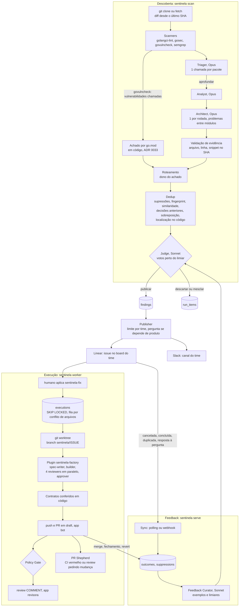

# Arquitetura

## Princípios

1. **Agente só onde há julgamento.** Scanners, roteamento, publicação, fila, validação de evidência
   e Policy Gate são código Go determinístico e testado. LLM entra em triagem, análise, julgamento,
   implementação e revisão.
2. **Contratos tipados.** Todo agente recebe e devolve JSON validado contra um schema
   (`schemas/`). Nada de texto livre entre etapas.
3. **Modelos definidos por perfil.** O padrão é qualidade: modelo forte onde há julgamento que não
   se recupera depois (triagem, análise, arquitetura, revisão de segurança e aprovação). O perfil
   economia fica para orçamento ou cota limitados ([custos.md](custos.md#perfis-de-modelos),
   ADR 0051).
4. **Idempotente e auditável.** Cada chamada de modelo fica em `llm_calls` (agente, modelo, tokens,
   custo, versão do prompt); cada decisão de agente, em `run_items`. Webhooks são deduplicados pela
   entrega.
5. **Seguro por padrão.** Worktree isolado, PR sempre em draft, nunca push na branch padrão, paths
   bloqueados, revisora que só comenta.
6. **Decisão humana é do humano.** Veja [seguranca.md](seguranca.md#decidir-e-executar).

## Fluxo



## Pontas e configuração

As pontas do fluxo são adaptadores (`adapters` no `sentinela.yaml`), e o meio é o mesmo em todos
os modos ([modos.md](modos.md), ADRs 0038 e 0039):

| Ponta | Implementações |
|---|---|
| tracker (`linear.Tracker`) | `linear_api` (cliente GraphQL, app OAuth), `linear_mcp` (MCP do Linear pelo `claude -p`), `local` (relatório em `reports/local` e decisões pela CLI) |
| notifier (`notify.Notifier`) | `slack_api` (bot), `slack_mcp`, `none` |
| git_host (`executor.AppAuth`) | `github_apps` (bot e revisora), `gh_cli` (conta do `gh`; o gate só comenta) |

A configuração pode vir de um arquivo só ou do `sentinela.yaml` mais um arquivo por time em
`config.d/teams/` (ADR 0041). O roteamento decide o time, o projeto (módulo > categoria > time >
repo > defaults, ADR 0040), o canal e a menção. Os serviços releem a config a cada ciclo.

## Agentes

Modelo do perfil qualidade (padrão) e, entre parênteses, o do economia quando muda.

| Agente | Tipo | Modelo | Entrada → saída |
|---|---|---|---|
| Scanner | código | — | repo e diff → sinais |
| Triager | LLM, 1 por pacote | Opus (Haiku) | código do pacote, vizinhos, sinais → aprofundar sim ou não |
| Analyst | LLM | Opus (Sonnet) | pacote → achados com evidência `arquivo:linha` |
| Architect | LLM, 1 por rodada | Opus (Sonnet) | grafo de dependências, resumos e linhas reais → achados entre módulos |
| Judge | LLM | Sonnet, 3 votos perto do limiar (1 voto) | achado, similares (léxicos e no mesmo lugar do código), exemplos humanos → publicar, descartar ou mesclar; confiança; depende de decisão de produto? |
| Review Note Interpreter | LLM | Sonnet | notas fora do escopo dos reviewers → achados candidatos |
| Feedback Curator | LLM | Sonnet (Haiku) | desfechos humanos → exemplos para o Judge e limiares |
| Publisher | código | — | achado aprovado → issue (ou pergunta) no board do time |
| Orquestrador | sessão do Claude Code (skill `sentinela-fix`) | Sonnet | job → chama os subagentes, retoma o builder e escreve `state.json` |
| Spec Writer | subagente do Claude Code | Sonnet | issue → `spec.md` (pulado quando o achado já tem critérios) |
| Builder | subagente do Claude Code | Sonnet, sem escalada (Opus) | spec → commits e `build.md` |
| Reviewers (segurança, código, confiabilidade, domínio) | subagentes do Claude Code | Opus (segurança), Sonnet | diff e spec → `review-*.md` |
| Approver | subagente do Claude Code | Opus | tudo acima → `decision.md` (APPROVE ou ESCALATE) |
| Policy Gate | código | — | decisão, política do time, CI, diff → aprova ou pede humano |
| PR Shepherd | Claude Code headless | Sonnet | CI vermelho ou review humana → novo commit (até 3 ciclos) |

Os prompts versionados ficam em `prompts/` (descoberta) e `plugins/sentinela-factory/` (linha de
execução); os schemas, em `schemas/`. O modelo de cada papel vem do `sentinela.yaml`, com override
por repo e por time (ADRs 0023 e 0024): o worker sobe a sessão com o modelo do `orchestrator` e
reescreve o `model:` de cada subagente do plugin a cada job.

## Grafo de dependências

O Architect recebe as arestas entre pacotes (diretórios) do repo, lidas dos imports sem compilar
nada (`internal/repo/deps.go`): Go pelo `module` do go.mod, Java e Kotlin pelo pacote, Python pelo
módulo. Em TypeScript e JavaScript (`internal/repo/tsgraph.go`), o import relativo vale como está
(um diretório com `index.ts` é o próprio diretório), e o não relativo segue a ordem do `tsc`:

1. `compilerOptions.paths` do `tsconfig.json` (ou `jsconfig.json`) mais próximo do arquivo, com
   `extends` (caminho relativo, lista ou pacote do workspace). O filho vence o pai, `paths`
   substitui o herdado, e os alvos partem do `baseUrl` ou, sem ele, do tsconfig que define `paths`;
2. o `baseUrl` sozinho (`import 'infra/db'` com `baseUrl: "src"`);
3. um pacote de workspace (npm, yarn ou pnpm) pelo `name` do package.json, com `exports`
   (subcaminhos, condições e `*`), `types`, `main` ou `module`. Quando a entrada aponta o build
   (`dist/index.js`), vale a fonte em `src/` com o mesmo caminho.

`import type`, `import { type X }` e `import('...')` em posição de tipo contam como aresta. Pacote de
fora do repo, `node:` e alias sem alvo no checkout ficam de fora.

## Contrato central: `Finding`

Todas as fontes produzem o mesmo `Finding`, o que permite trocar ou acrescentar fontes sem mexer no
Judge, no Publisher nem no executor.

```json
{
  "source": "code_analysis | sentry | datadog | review_note",
  "repo": "acme/monorepo", "module": "services/billing", "owners": ["@acme/payments"],
  "routing": {"team": "payments", "linear_team": "PAY", "linear_project": "", "assignee": "", "rule": "config:services/billing/**"},
  "category": "bug | performance | improvement | security",
  "severity": "critical | high | medium | low",
  "confidence": 0.8,
  "title": "imperativo, curto",
  "context": "por que importa",
  "evidence": [{"file": "services/billing/invoice.go", "line": 42, "permalink": "", "snippet": "código literal"}],
  "signals": [{"kind": "scanner | review_note", "ref": "", "summary": ""}],
  "proposed_fix": "o que mudar e onde",
  "acceptance_criteria": ["verificável"],
  "scope_paths": ["services/billing"],
  "fingerprint": "sha1(repo|categoria|arquivo|problema)[:12]"
}
```

Toda evidência é conferida no código do SHA analisado: o arquivo existe, a linha está dentro dele e
o snippet aparece perto da linha. Evidência inválida sai do achado; achado sem nenhuma evidência
válida é descartado.

## Linha de execução: contratos do plugin

Cada subagente escreve exatamente um arquivo, e a primeira linha é o veredito. Só a skill
orquestradora escreve `state.json`. O worker confere tudo em código depois da sessão; arquivo
faltando ou primeira linha errada vira `failed`.

| Arquivo | Primeira linha |
|---|---|
| `spec.md` | `SPEC: READY` ou `SPEC: BLOCKED` |
| `round-N/build.md` | `STATUS: READY` ou `STATUS: BLOCKED` |
| `round-N/review-{security,code,reliability,domain}.md` | `VERDICT: PASS` ou `VERDICT: CHANGES` |
| `decision.md` | `APPROVE` ou `ESCALATE` |
| `shepherd-N/result.md` | `STATUS: FIXED` ou `STATUS: BLOCKED` |

Rodadas:
- Se algum reviewer pede mudança, o mesmo builder é retomado, com no máximo 3 rodadas.
- Rodadas esgotadas viram ESCALATE.
- Com as quatro lentes aprovando, o approver decide.

## Banco (Postgres 16 + pgvector)

| Tabela | Conteúdo |
|---|---|
| `analysis_runs` | rodadas: descoberta, notas de review, rejulgamento; estado e estatísticas |
| `run_items` | cada decisão de agente da rodada (triagem, análise, Judge, votos), com o motivo |
| `findings` | achados aprovados: estado, embedding, roteamento, premissa, duplicata (`merged_into`), origem |
| `linear_issues` | issues publicadas (principal e relacionadas), com o estado sincronizado |
| `suppressions` | o que não deve voltar: fingerprint ou padrão, com motivo e validade |
| `outcomes` | desfechos: aceito, recusado, mesclado, duplicado, fechado, revertido; quem decidiu e quem executou |
| `feedback_examples`, `thresholds` | o que o Curator aprendeu |
| `executions` | fila e estado dos jobs da linha de execução, PR, gate, shepherd |
| `reviews` | um registro por review de cada rodada (métrica por lente) |
| `llm_calls`, `prompt_versions` | contabilidade de cada chamada de modelo |
| `webhook_events` | deduplicação de webhooks e do polling |

Estados de um achado: `open`, `executing`, `fixed`, `rejected`, `reverted`, `stale`. As migrations
ficam em `internal/store/migrations/` (goose, todas com `down`) e o acesso, em `sqlc`.

## Pacotes

| Pacote | Responsabilidade |
|---|---|
| `cmd/sentinela` | binário e subcomandos |
| `internal/config` | `sentinela.yaml`, padrões e validação |
| `internal/repo` | git, mapa de pacotes, CODEOWNERS, roteamento |
| `internal/scan` | adaptadores dos scanners |
| `internal/signals`, `internal/signals/code` | contrato `Finding` e a fonte de análise de código |
| `internal/agents/*` | um pacote por agente: request, parse, testes com respostas gravadas |
| `internal/llm` | Claude Code (assinatura), API da Anthropic, replay; orçamento e custo |
| `internal/discovery` | rodada de descoberta, dedup, Judge, notas de review, rejulgamento |
| `internal/linear` | publisher, sync e webhook do Linear |
| `internal/notify` | Slack |
| `internal/feedback` | Feedback Curator, exemplos e limiares |
| `internal/executor` | worker, worktree, plugin, contratos, PR, shepherd, webhook do GitHub |
| `internal/gate` | Policy Gate |
| `internal/github` | GitHub REST e GitHub Apps |
| `internal/report` | relatório HTML da rodada |
| `internal/store` | banco, migrations, consultas geradas |

As decisões de arquitetura, uma por arquivo, estão em [adr/](adr/). Elas registram medições feitas
nos repositórios de teste do ambiente de desenvolvimento.
