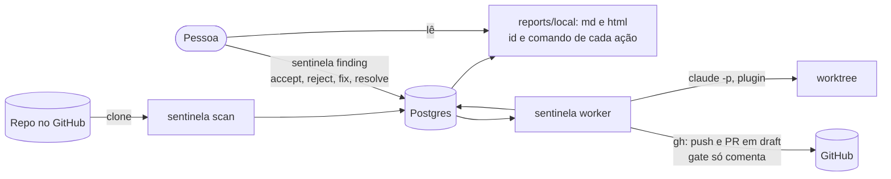
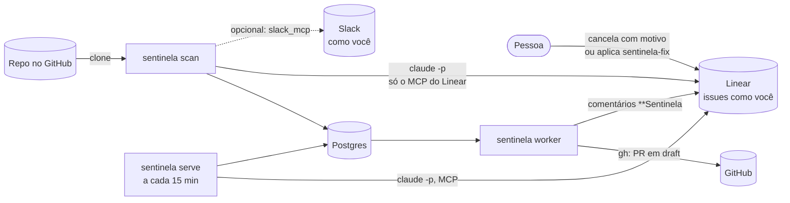
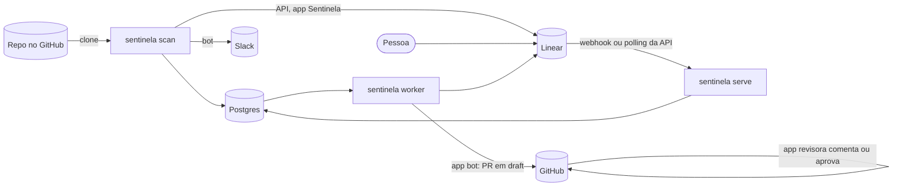

# Modos de operação

O Sentinela roda em três modos. Em todos, o **Postgres é o mesmo e é obrigatório**: ele guarda os
achados, as supressões, as decisões humanas, a fila de execução, as métricas e o custo de cada
chamada. Os modos só trocam as pontas:

- por onde os achados saem;
- por onde as decisões voltam;
- quem avisa;
- quem abre o PR.

Essas pontas são os adaptadores em `adapters` no `sentinela.yaml`
([configuracao.md](configuracao.md#adapters), ADRs 0038 e 0039).

| | Local | MCP | Completo |
|---|---|---|---|
| `adapters.tracker` | `local` | `linear_mcp` | `linear_api` |
| `adapters.notifier` | `none` | `none` ou `slack_mcp` | `slack_api` |
| `adapters.git_host` | `gh_cli` | `gh_cli` | `github_apps` (ou `gh_cli`) |
| Exige | Docker, `claude` logado, `gh` logado | O mesmo, mais o MCP do Linear (e o do Slack) conectado no Claude Code | App OAuth do Linear, bot do Slack, duas GitHub Apps ([integracoes.md](integracoes.md)) |
| Chaves no `.env` | Nenhuma além do `DATABASE_URL` | Nenhuma além do `DATABASE_URL` | `LINEAR_OAUTH_*`, `SLACK_BOT_TOKEN`, `GITHUB_*_APP_*` |
| Achados aparecem em | `reports/local/<repo>.md` e `.html` | Issues no Linear, criadas com a sua conta | Issues no Linear, criadas pelo app Sentinela |
| Decisões entram por | `sentinela finding accept \| reject \| fix \| resolve` | O Linear (cancelar, `sentinela-fix`), lido pelo MCP | O Linear, por webhook ou polling da API |
| PR em draft | Pela sua conta (`gh`); o gate só comenta | Pela sua conta (`gh`); o gate só comenta | Pela app bot; a app revisora comenta (ou aprova, se liberado) |
| Para quê | Avaliar em 10 minutos ([avaliacao.md](avaliacao.md)) | Usar com o time no Linear sem criar apps | Uso real, com identidade própria |

A configuração de qualquer modo pode ser um arquivo só ou o principal mais um arquivo por time em
`config.d/teams/` (ADR 0041). O passo a passo, do zero até o cenário completo de uma organização
com monorepo, está em [guia-configuracao.md](guia-configuracao.md); como um time adiciona o seu
módulo ou projeto, em [CONTRIBUTING.md](../CONTRIBUTING.md). Para uso numa empresa (provider, onde
rodar, identidade, permissões e o caminho local → MCP → completo), veja [empresa.md](empresa.md).

## O que cada modo suporta

Tabela conferida no código em 2026-10-11 e coberta pelos smoke tests de cada modo
(`TestSmokeFullMode`, `TestSmokeLocalMode`, `TestSmokeMCPMode` em `internal/executor`, e os testes
de `init` e `config validate` em `internal/cli`).

| Recurso | Completo | MCP | Local |
|---|---|---|---|
| `sentinela init --mode` | não (instalação manual: [instalacao.md](instalacao.md)) | `--mode mcp` | `--mode local` |
| `config validate` contra o tracker | Linear (API), Slack, GitHub Apps | Linear pelo MCP; Slack não é conferido | não confere tracker |
| `config validate --offline` e `--changed` | sim | sim | sim |
| Descoberta (`scan`, `scan --all`) | sim | sim | sim |
| Onde os achados aparecem | issues no Linear, como o app | issues no Linear, como você | `reports/local/*.md` e `.html` |
| Limite de issues por time por rodada | sim | sim | não se aplica (o relatório mostra todos) |
| Issues relacionadas (achado entre módulos) | sim | sim (`relatedTo` pelo MCP) | não (só o achado principal no relatório) |
| Responsável (`assignee`) | sim | sim (pelo e-mail) | não |
| Projeto por módulo e por categoria | sim | sim | não se aplica |
| Recusar (vira supressão) | cancelar a issue com o motivo | cancelar a issue com o motivo | `finding reject` |
| Aceitar sem corrigir | não há gesto próprio | não há gesto próprio | `finding accept` |
| Pedir a correção | label de gatilho (por time) | label de gatilho (por time) | `finding fix` |
| Corrigido à mão | concluir a issue | concluir a issue | `finding resolve --note` |
| Duplicata humana | marcar Duplicate | marcar Duplicate | `finding duplicate --of` |
| Pergunta de produto (`question`, `intentional`, `not_intentional`) | labels na issue | labels na issue | `finding answer intentional \| not-intentional` |
| Quem pode disparar a correção (`fix_trigger`) | sim: gatilho e instruções da equipe | só as instruções da equipe (o MCP não mostra quem aplicou a label) | não se aplica |
| "Também afeta" (times secundários) | sim | sim | não (só o dono) |
| Comentários da equipe na spec | sim | sim | não |
| Comentário, label de resultado e estado na issue | sim, como o app | sim, como você, com o prefixo `**Sentinela` | não (o relatório mostra o job e o PR) |
| PR em draft | app bot | `gh` (sua conta) | `gh` (sua conta) |
| Gate aprova o PR | sim, com `reviewer_approves` e a política do time | não, só comenta | não, só comenta |
| PR Shepherd (CI vermelho, review pedindo mudança) | sim | sim | sim |
| Webhook | Linear e GitHub | não (polling com intervalo próprio) | não se aplica |
| Avisos no Slack | bot, canal e menção por time | opcional, `slack_mcp`, como você | não |
| Identidade própria | sim | não | não se aplica |
| Feedback Curator, supressões e métricas | sim | sim | sim |
| Releitura da config a cada ciclo e `config.d/teams` | sim | sim | sim |

## Modo local



- **Saída:** a cada rodada e a cada decisão, o relatório de cada repo é regenerado do Postgres.
  Cada achado traz o id (`F-<id>`) e o comando de cada ação possível naquele estado.
- **Decisões (CLI):** todas gravam `decided_by human`, como as do Linear.
  - `accept <id>`: é um problema real. O achado continua aberto, esperando a correção, e conta
    como aceito no Curator.
  - `reject <id> "<motivo>"`: o achado vira `rejected`, e o motivo vira supressão e exemplo para o
    Judge.
  - `fix <id>`: equivale a aplicar a label de gatilho. Enfileira o job; num achado já aceito com
    job que falhou, só reenfileira, sem nova decisão.
  - `resolve <id> --note "<como>"`: a correção foi feita à mão. Fecha o achado como `fixed`.
  - `duplicate <id> --of F-<outro>`: é o mesmo problema. O mais antigo absorve o mais novo, sem
    supressão, como marcar Duplicate no Linear.
  - `answer <id> intentional | not-intentional`: responde à pergunta de produto. Se é intencional,
    vira recusa com supressão; se não é, vira achado normal, aceito.
  - `list` e `show` funcionam em qualquer modo; as quatro ações acima, só no modo local.
- **Quem executa:** `--executed-by agent --note "..."` registra que um agente executou a pedido de
  quem decidiu (princípio 6).

## Modo MCP



- **Como chama o Linear:** cada operação no Linear é uma chamada `claude -p` com só as ferramentas
  do MCP configurado permitidas (`--tools ToolSearch --allowedTools mcp__claude_ai_Linear`). Ela
  usa o modelo mais barato de `pricing.models` e grava em `llm_calls` com o agente `linear_mcp`.
- **Como gasta pouco:**
  - Times, estados e labels são lidos uma vez por processo.
  - **Um ciclo de leitura é uma chamada só**, qualquer que seja o número de issues abertas. A cada
    `adapters.mcp.poll_interval` (padrão 15m), uma chamada lista, em cada time do Linear da
    config, as issues com a label de achado (`labels.finding`) atualizadas desde a listagem
    anterior. A primeira listagem de cada processo traz todas.
  - Entre listagens, o gatilho do worker e o sync usam o estado guardado.
  - Só as issues que nenhuma listagem trouxe (sem a label, ou de um time fora da config) são lidas
    com `get_issue`, também numa chamada só.
- **Estado lido na hora antes de mudar:** antes de mover uma issue para revisão ou concluído, o
  worker lê o estado na hora, para não desfazer uma decisão sua recente que o estado guardado
  ainda não mostra.
- **Decisões:** são as mesmas do modo completo:
  - cancelar a issue com um comentário vira recusa com supressão;
  - aplicar `sentinela-fix` pede a correção;
  - marcar como Duplicate é mesclagem humana.

  Elas chegam com até um intervalo de atraso.
- **Identidade:** as ações do Sentinela saem com a sua conta. Os comentários começam com
  `**Sentinela`, e o sync separa o que é do Sentinela pelo prefixo, porque o autor é o mesmo.
  Para uso real, o certo é o app OAuth do modo completo (ADR 0032).
- **Mudanças de estado do próprio Sentinela não viram decisão**, mesmo saindo com a sua conta. O
  sync não olha quem mudou o estado: ele só transforma um estado em decisão quando o achado ainda
  está pendente (`open` ou `executing`).
  - O Sentinela move para revisão quando abre o PR. É um estado do tipo `started`, que o sync
    nunca trata como decisão.
  - O Sentinela só move para concluído depois de gravar o desfecho do merge e fechar o achado como
    `fixed`.
  - Concluir ou cancelar a issue enquanto o achado está pendente continua sendo decisão sua.

## Modo completo



- **Identidade própria:** issues, comentários e mudanças de estado saem como o app Sentinela, e o
  sync identifica o Sentinela pelo autor.
- **Avisos:** o bot do Slack posta no canal de cada time.
- **GitHub:** duas GitHub Apps. A revisora só aprova se `github_apps.reviewer_approves` e a política
  do time permitirem.

## Labels configuráveis

As labels valem para os trackers do Linear (`linear_api` e `linear_mcp`). No modo local, o gatilho
é o `finding fix`. Com tracker, o `config validate` confere se as labels existem no time do Linear.
As trocadas por time são erro se faltarem; as da organização, aviso.

| Label | Padrão | Organização (`labels.*`) | Time (`teams.<time>.labels.*`) | Quem aplica |
|---|---|---|---|---|
| Achado | `sentinela` | `finding` | — | Sentinela, em toda issue |
| Gatilho | (sem padrão) | `trigger` | `trigger` | Uma pessoa: pede a correção |
| Resultado | (sem padrão) | `done` | `done` | Sentinela: PR em draft aberto |
| Falha | (sem padrão) | `failed` | `failed` | Sentinela: a linha de execução falhou |
| Pergunta | (sem padrão) | `question` | — | Sentinela: depende de decisão de produto |
| Resposta | (sem padrão) | `intentional`, `not_intentional` | — | Uma pessoa: é ou não é intencional |

O exemplo (`sentinela.example.yaml`) e o `init` usam `sentinela-fix`, `sentinela-done` e
`sentinela-failed`. Um time que troca a sua label de gatilho não dispara com a da organização. O
Sentinela nunca aplica uma label de gatilho, nem a da organização nem a de nenhum time.

## Limitações

| | Local | MCP | Completo |
|---|---|---|---|
| Identidade | Não se aplica | Tudo sai com a sua conta; o Sentinela é reconhecido só pelo prefixo `**Sentinela` | App próprio no Linear, bot no Slack, apps no GitHub |
| Custo das leituras | Nenhum | Uma chamada `claude -p` por ciclo e por processo (cerca de 192 por dia com 15 min), qualquer que seja o número de issues; gasta a cota da assinatura | Chamadas de API, sem cota de modelo |
| Gatilho | Imediato (`finding fix`) | Até `poll_interval` de atraso; sem webhook | Webhook ou polling da API |
| Gate | Só comenta: o PR é seu, e o GitHub não deixa aprovar o próprio PR | Só comenta, pelo mesmo motivo | A revisora comenta ou aprova, conforme a política |
| Instruções da equipe na spec | Não há (sem comentários) | Sim, pelos comentários da issue | Sim |
| Avisos | Nenhum | Com `slack_mcp`, como você, com uma chamada por aviso | Bot, no canal de cada time |

### Quanto custa o polling no modo MCP

Cada leitura é uma chamada `claude -p` com o modelo mais barato. O `serve` (sync) e o `worker`
(gatilho) são processos separados, e cada um lista no máximo uma vez por `poll_interval` enquanto
houver issues do Sentinela abertas. Com 15 minutos, são 4 ciclos por hora em cada um.

| Issues abertas | Antes (até 2026-10-11): por ciclo | Agora: por ciclo | Chamadas de leitura por dia (serve + worker) |
|---|---|---|---|
| 10 | 1 chamada, com 10 `get_issue` dentro | 1 chamada, com 1 `list_issues` por time | cerca de 192 |
| 50 | 1 chamada, com 50 `get_issue` | 1 chamada, com 1 `list_issues` por time | cerca de 192 |
| 200 | 1 chamada, com 200 `get_issue` (sessão longa, tokens crescendo com N) | 1 chamada, com 1 `list_issues` por time; volta só o que mudou | cerca de 192 |

- **O que cresce com o número de issues** é só a primeira listagem de cada processo, depois de
  subir ou reiniciar: ela traz todas as issues com a label, em páginas de 250.
- **O que soma às leituras de ciclo:**
  - cada issue publicada: 2 ou 3 chamadas (busca pelo marcador e criação);
  - cada recusa lida: 1 chamada, para o motivo;
  - cada job: algumas chamadas (spec, comentários, labels, leitura na hora antes de mover o
    estado).
- **Tempo:** no teste de 2026-10-11, a média foi de 9,6 s por chamada.

O `sentinela status` mostra o número real dos últimos 7 dias:

```
MCP (7 dias): 1410 chamada(s) claude -p, 201/dia; 1344 ciclo(s) de leitura, 1.0 chamada(s) de leitura por ciclo; 9.6 s em média; 0 com erro
```

O exemplo acima é ilustrativo. Aumente `adapters.mcp.poll_interval` se as decisões puderem
esperar mais: com 30 minutos, as leituras de ciclo caem pela metade.

## Ordem sugerida de adoção

1. **Local:** avalie os achados num repo seu sem criar nada fora da máquina
   ([avaliacao.md](avaliacao.md)). Recuse o que não presta: as supressões e os exemplos ficam no
   Postgres e já calibram as próximas rodadas.
2. **MCP:** ponha o time para decidir no Linear, sem criar apps. Bom para um piloto.
3. **Completo:** crie o app OAuth, o bot e as GitHub Apps quando o Sentinela for de uso real. Isso
   dá identidade própria e webhook, e libera a aprovação pela app revisora, se o time quiser.

## Migrar entre modos sem perder o histórico

O Postgres é o mesmo e nenhum modo tem esquema próprio. Migrar é trocar `adapters` no
`sentinela.yaml` e reiniciar os serviços.

**Local para MCP:**

1. Ponha `adapters.tracker: linear_mcp`, `defaults.linear.team` e `publish.enabled: true`. Também
   dá para rodar `sentinela init --mode mcp --config outro.yaml` e copiar os blocos.
2. Os achados abertos e sem issue saem no Linear na próxima rodada, até
   `publish.max_issues_per_team_per_run` por time (padrão 3). Sem commits novos, um `scan`
   incremental não chama modelos e só publica os pendentes. Os gravados no modo local não têm time
   do Linear no roteamento e saem no de `defaults.linear`.
3. Recusas, aceites, supressões, exemplos do Curator e métricas continuam valendo.
4. Achados com job em andamento no modo local (branch `sentinela/F-<id>`) terminam normalmente.

**MCP para completo:**

1. Configure `linear_auth`, rode `sentinela linear auth` e troque o tracker para `linear_api`.
2. As issues criadas pelo MCP são issues comuns do Linear e o `linear_issues` guarda o UUID delas,
   então a API segue lendo e decidindo sobre as mesmas issues.
3. Ponha em `linear_auth.legacy_prefix_until` a data da troca. Assim, os comentários com o prefixo
   `**Sentinela` feitos pela sua conta antes dela continuam reconhecidos como do Sentinela, e não
   viram instruções da equipe.
4. Troque `slack_mcp` por `slack_api` (bot) e `gh_cli` por `github_apps` quando as apps
   existirem.

**De volta para local:** `adapters.tracker: local`. As issues que já existem no Linear ficam lá,
mas as decisões passam a ser só pela CLI.
